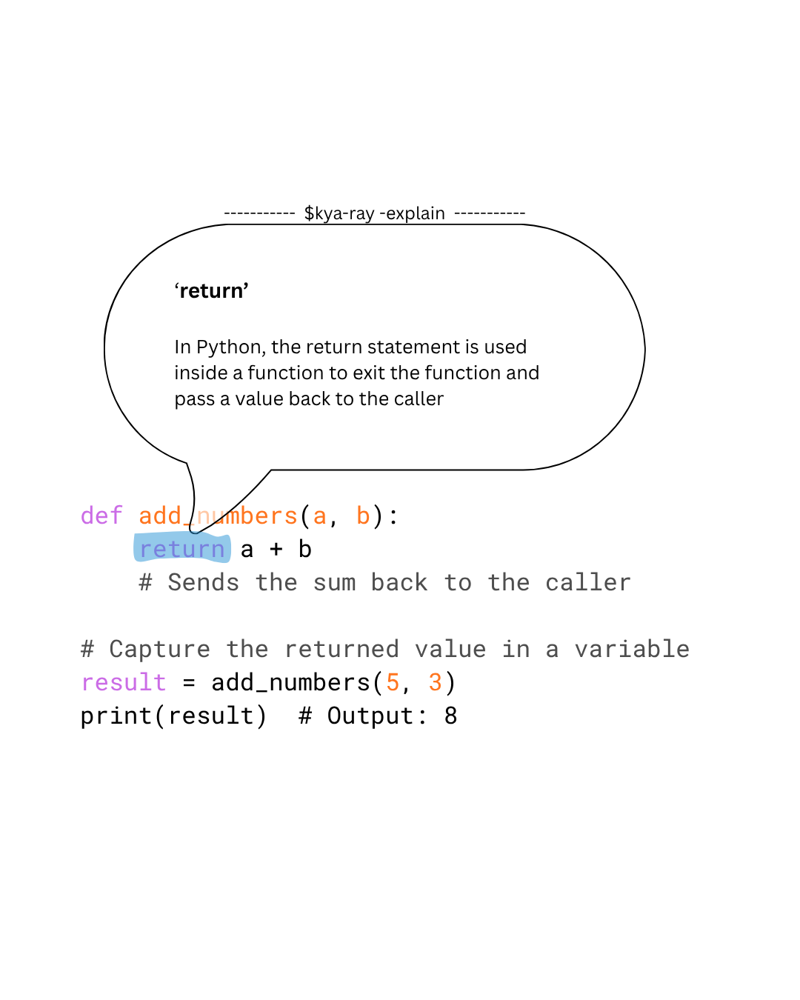

# Kya-Ray

*A little context-aware AI companion.*

Kya-Ray helps you understand and work with whatever you're looking at, right where you are.

Select something. Call Kya-Ray. Keep going.

The goal is simple: Kya-Ray should understand what you need without making you choose a mode.

- **Explain** unfamiliar words and concepts.
- **Summarize** longer passages.
- **Compare** ideas and options.
- **Code** and help complete what you're working on.

The model should infer the right action from your selection and context.

Currently in development. Built around local AI, with privacy and staying out of your way at the center.

