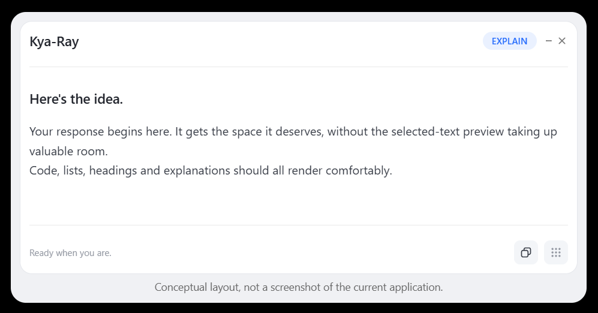
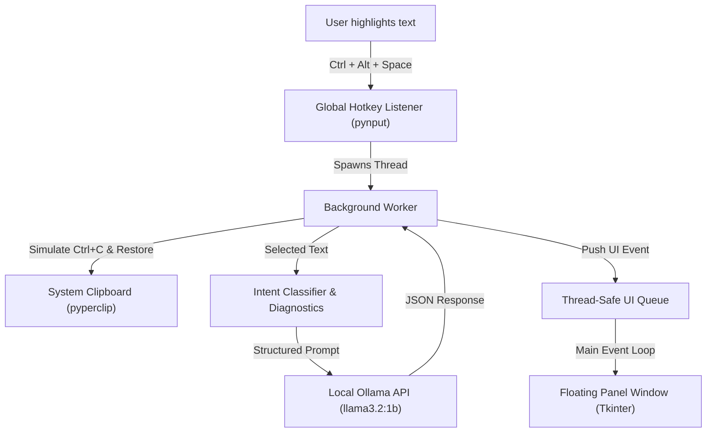

# Kya-Ray

*A little context-aware AI desktop companion.*

Kya-Ray helps you understand and work with whatever you are looking at, right where you are.

Select something. Press **`Ctrl + Alt + Space`**. Keep going.



---

## What is Kya-Ray?

When reading documentation, reviewing code, studying technical papers, or writing messages, you often encounter unfamiliar terms, complex code snippets, or lengthy paragraphs. The traditional workflow requires switching applications, opening a browser tab, pasting the text into an AI chat interface, typing a prompt, and switching back.

Kya-Ray streamlines this interaction into a single keystroke:

1. **Highlight text** in any application (browser, IDE, PDF reader, terminal, or office suite).
2. **Press `Ctrl + Alt + Space`**.
3. A compact, minimal floating panel appears immediately near your cursor with a clear, concise AI-generated answer.

Kya-Ray operates **100% locally** using [Ollama](https://ollama.com) and Meta's **Llama 3.2 1B** model. Zero data is transmitted to the cloud, and your clipboard is automatically restored after text capture.

---

## How It Works



1. **Selection & Activation**: When `Ctrl + Alt + Space` is pressed, the global keyboard hook catches the combination without blocking other desktop applications.
2. **Context Capture**: Kya-Ray saves the existing clipboard contents, simulates a copy command (`Ctrl + C`) to grab the selected text, and immediately restores the previous clipboard state.
3. **Intent Classification**: A deterministic heuristic classifier examines the highlighted text to select the most appropriate intent without requiring manual mode switching.
4. **Local Model Inference**: The structured prompt is dispatched asynchronously to the local Ollama REST endpoint (`http://127.0.0.1:11434/api/generate`).
5. **Formatted Presentation**: The response is queued safely to Tkinter's main thread and rendered in an understated, floating card positioned near your mouse cursor.

---

## Features

### Intelligent Intent Classification

Kya-Ray automatically determines what kind of assistance you need based on the structure and content of your selection:

| Intent | Trigger Criteria | Behavior & Guardrails |
| :--- | :--- | :--- |
| **Explain** | Concepts, definitions, terms, idioms, and explanatory questions (`what is`, `how does`). | Explains clearly in 1–2 beginner-friendly sentences. Strict anti-hallucination rules prevent inventing facts or origins for unfamiliar terms. |
| **Summarize** | Long prose ($\ge 50$ words), multi-paragraph text, bulleted notes, or explicit `summarize` requests. | Condenses essential meaning into 1–2 short sentences without losing key takeaways. |
| **Code** | Code definitions, assignments, terminal commands, stack traces, and programming syntax. | Explains what the code or shell command does. Static analysis (`ast` + `difflib`) detects package typos (e.g. `panadas` $\to$ `pandas`) and suggests corrections without silently rewriting user code or inventing errors on valid code. |
| **Create** | Writing directives (`write an email`, `draft a reply`, `give me a cute pickup line`). | Generates the requested output directly. Defaults to 1 clean output for singular requests, respects explicit quantities ($N$ options), and strips conversational preambles (e.g. *"I'd be happy to..."*). |

### Minimal Floating UI

- **Light Card Theme**: Restrained white background (`#ffffff`), high-contrast slate body text (`#0f172a`), subtle sky-blue identity accent (`#0284c7`), and slate border (`#e2e8f0`). Enforced consistently across Windows light and dark modes.
- **Context-Anchored Positioning**: Automatically floats directly above or below your cursor clamped to screen boundaries.
- **Dynamic Window Sizing**: Smoothly adjusts height (170px to 340px) to match response length without awkward empty space.
- **Formatted Typography**: Renders bold text, bulleted lists, numbered lists, inline code (`code`), and fenced code blocks (`Consolas`) with soft backgrounds.
- **One-Click Copy**: Understated "Copy" button copies the response to your clipboard with transient "Copied!" feedback.
- **Unobtrusive Controls**: Dismiss with `Esc` or `✕` without terminating the background process. Reposition anywhere by dragging. Deliberate `Exit` button and right-click menu for clean shutdown.

### Local Privacy & Zero Data Leakage

- **100% Offline**: All inference runs locally on `http://127.0.0.1:11434`. No accounts, no API keys, and no telemetry tracking your reading habits.
- **Automatic Clipboard Restoration**: Original clipboard data is backed up before capture and restored immediately after.

---

## Technology Stack

| Component | Technology | Role |
| :--- | :--- | :--- |
| **Runtime** | Python 3.10+ (tested on Python 3.13) | Core runtime environment. |
| **GUI Framework** | Tkinter | Native Windows floating panel, canvas polygon rendering, transparent window keys. |
| **Global Hooks** | `pynput` (1.8.2) | Low-level Windows global keyboard event monitoring and synthetic keystrokes. |
| **Clipboard Bridge** | `pyperclip` (1.11.0) | Cross-application text capture and clipboard preservation. |
| **Local AI Engine** | Ollama | Local model server providing REST API on `localhost:11434`. |
| **Default Model** | Llama 3.2 1B (`llama3.2:1b`) | Compact, high-speed language model (~1.3 GB download). |
| **Static Analysis** | `ast`, `difflib`, `re` (Standard Library) | Deterministic Python syntax parsing and package typo matching. |
| **Networking & Concurrency** | `urllib.request`, `threading`, `queue` | Non-blocking HTTP API communication and thread-safe UI updates. |
| **Windows Packaging** | PyInstaller (6.22.3) | Standalone Windows x64 executable packaging (`onedir`). |

---

## Architecture

Kya-Ray uses a clean multi-threaded pipeline separating keyboard monitoring, network I/O, and UI event processing:

```
[Application Startup]
   │
   ├── setup_safe_logging() ────────► Logs to %LOCALAPPDATA%\Kya-Ray\kya-ray.log
   ├── check_ollama_prerequisites() ─► Asynchronous startup health check
   ├── pynput.keyboard.Listener ────► Background thread monitoring Ctrl + Alt + Space
   └── root.mainloop() ─────────────► Main Tkinter event loop & ui_queue polling
```

- **Entry Point (`prototype/main.py`)**: Initializes application state, logging, and prerequisite checks.
- **Hotkey Listener**: Dedicated listener thread tracking `Ctrl`, `Alt`, and `Space` states with repeat-suppression debouncing.
- **Background Worker**: Dedicated daemon thread spawned on each activation to handle clipboard capture, intent inference, prompt construction, and Ollama HTTP communication without freezing the desktop.
- **Thread-Safe Queue (`ui_queue`)**: Bridges background worker threads to Tkinter's single-threaded UI event loop.
- **Floating Panel (`FloatingBubbleWindow`)**: Borderless, topmost window using Win32 `GetCursorPos` for intelligent cursor-anchored placement.

---

## Project Structure

```
kya-ray/
├── assets/
│   └── kya-ray-vision.png        # Product architecture and vision diagram
├── features/                     # Feature specification markdown system
│   ├── 01-core-interaction.md    # Global shortcut and activation lifecycle
│   ├── 02-context-capture.md     # Clipboard bridge and restoration spec
│   ├── 03-hyphen-features.md     # Intent taxonomy and classification rules
│   ├── 04-ai-response-engine.md  # Ollama integration and prompt architecture
│   ├── 05-floating-bubble-ui.md  # UI design, positioning, and widget specs
│   ├── 06-performance-and-reliability.md # Latency profiler and benchmarks
│   ├── 07-privacy-and-security.md # Data boundaries and sanitization rules
│   ├── 08-roadmap.md             # Phased engineering roadmap toward v1.0.0
│   └── README.md                 # Specifications index and guidance
├── prototype/
│   ├── main.py                   # Complete Kya-Ray application implementation
│   ├── latency_test.py           # Standalone Ollama inference latency benchmark
│   └── pipeline_profiler.py      # UDP high-resolution telemetry profiler
├── tests/
│   ├── test_bubble_ui.py         # UI widgets, theme enforcement, sizing, copy
│   ├── test_hotkey.py            # Hotkey detection, latching, and debouncing
│   └── test_intents.py           # Intent classification, prompts, diagnostics
├── dev_flow.md                   # Engineering version log (V1 through V7)
├── kya-ray.spec                  # PyInstaller Windows build specification
├── requirements.txt              # Production Python package dependencies
├── README.md                     # Main project documentation (this file)
├── README_BETA.md                # Quickstart guide bundled with Windows release
└── START_KYA_RAY.bat             # Windows launcher script with Ollama health check
```

---

## Installation & Setup

### Using the Pre-Built Windows Package

The latest release is **`v0.1.0-beta`** (Windows x64).

1. **Install Ollama**: Download and install Ollama for Windows from [ollama.com/download/windows](https://ollama.com/download/windows).
2. **Download the Model**: Open PowerShell or Command Prompt and download Llama 3.2 1B:
   ```shell
   ollama pull llama3.2:1b
   ```
   *(Download size: ~1.3 GB. Runs completely locally on your CPU or GPU.)*
3. **Download Kya-Ray**: Download `Kya-Ray-v0.1.0-beta-win64.zip` from the [Releases](https://github.com/dumbgesh/kya-ray/releases) page.
4. **Extract & Run**: Extract the ZIP anywhere and double-click **`START_KYA_RAY.bat`** (or `Kya-Ray\Kya-Ray.exe`).
5. **Use**: Highlight text in any application and press **`Ctrl + Alt + Space`**.

### Controls Summary

| Action | Control |
| :--- | :--- |
| **Trigger Assistant** | `Ctrl + Alt + Space` (with text highlighted) |
| **Dismiss Panel** | Press `Esc` or click `✕` in top-right |
| **Copy Response** | Click `Copy` button |
| **Reposition Panel** | Click and drag anywhere on the window |
| **Context Menu** | Right-click anywhere on the panel |
| **Exit Kya-Ray** | Click `Exit` in top-right, or right-click $\to$ *Exit Kya-Ray completely* |

> [!NOTE]
> Pressing `Esc` only dismisses the visible response panel. It does not terminate the background listener while you continue working in other applications.

---

## Development Setup

To run or develop Kya-Ray from source code:

### 1. Prerequisites
- Windows 10 or 11 (64-bit)
- Python 3.10 or newer (tested on Python 3.13)
- Git
- Ollama running locally with `llama3.2:1b`

### 2. Clone and Setup Environment
```powershell
# Clone the repository
git clone https://github.com/dumbgesh/kya-ray.git
cd kya-ray

# Create and activate a virtual environment
python -m venv .venv
.\.venv\Scripts\Activate.ps1

# Install dependencies
pip install -r requirements.txt
```

### 3. Run from Source
```powershell
python prototype/main.py
```

### 4. Build Windows Distribution Package
```powershell
pyinstaller -y --clean kya-ray.spec
```
The compiled standalone package will be located in `dist\Kya-Ray\Kya-Ray.exe`.

---

## Automated Testing

Kya-Ray uses Python's standard `unittest` framework with automated regression suites covering hotkey detection, UI widgets, theme enforcement, and prompt reliability.

To run the full test suite:

```powershell
python -m unittest discover tests -v
```

### Verified Test Suite Breakdown (75 tests total)

- **`tests/test_bubble_ui.py` (18 tests)**:
  - Theme dictionary structure and consistent light palette enforcement (`#ffffff` fill, `#0f172a` text, `#0284c7` title).
  - FloatingBubbleWindow widget hierarchy, aliases, and state transitions (`generating`, `explanation`, `error`, `no-selection`).
  - Cursor-anchored positioning, boundary clamping, and dynamic height scaling.
  - Formatted response tags (`body`, `bold`, `bullet`, `code_inline`, `code_block`).
  - Copy button functionality and transient feedback.
  - Comic bubble polygon backward-compatibility calculations.
- **`tests/test_hotkey.py` (5 tests)**:
  - Key recognition across Ctrl, Alt, and Space variants (`Key.space`, virtual key code 32, `' '`).
  - Modifier key sets (left/right Ctrl and Alt support).
  - Background worker thread triggering upon valid combination.
  - Repeat-suppression debouncing when holding keys down.
- **`tests/test_intents.py` (52 tests)**:
  - Intent classification across terminal commands (`git`, `docker`, `pip`), code syntax (`FastAPI`, `def`, `class`), and multiline typed declarations (`int a = 1`).
  - Negative prose tests preventing false code classifications on ordinary English words (*"international"*, *"integral"*).
  - Ambiguous edge-case handling (*"Summarize this code"*, *"Write a function"*, *"Explain how to write a function"*).
  - Math formula separation (`y = mx + b` $\to$ Explain vs. `app = FastAPI()` $\to$ Code).
  - Deterministic static code diagnostics (`check_code_diagnostics`) identifying genuine package typos (`panadas` $\to$ `pandas`) without flagging valid internal imports.
  - Creative output control: single output by default, explicit quantity preservation, preamble stripping, and multi-paragraph document preservation.
  - Curly-brace safety in prompt formatting and mock Ollama HTTP integration.

---

## Current Release Status

The current public release is **`v0.1.0-beta`** (Windows x64):

- **Package**: `dist\Kya-Ray-v0.1.0-beta-win64.zip` (11.85 MB)
- **Git Release Tag**: `v0.1.0-beta`
- **Release Commit**: `035915021670cb01b8a660895108aac4712b5cae`
- **Archive SHA256 Checksum**: `940622ce0337ea51a2a01d909771357cde29bf125a199f540eed1bfd6fad65e8`

---

## Known Limitations

1. **Local Model Dependency**: Kya-Ray relies on a running Ollama server instance and requires the `llama3.2:1b` model installed locally. It is not currently a zero-dependency self-contained installer.
2. **Clipboard Capture in Specialized Apps**: Text selection capture relies on standard synthetic `Ctrl + C` emulation. Certain elevated applications, games, or legacy software with non-standard clipboard handling may ignore synthetic copy events.
3. **Hardware Latency Variation**: Inference latency directly depends on host CPU/GPU performance. While warm responses typically take 1–3 seconds, cold starts on slower hardware may take longer.
4. **Primary Display Clamping**: Cursor positioning and screen clamping are currently calibrated for the primary desktop monitor bounds.

---

## Roadmap Towards v1.0.0

Kya-Ray is actively progressing from the initial beta release toward a stable **v1.0.0** desktop release.

### Verified in v0.1.0-beta
- [x] Global `Ctrl + Alt + Space` shortcut detection with debouncing
- [x] Non-blocking clipboard capture and automatic restoration
- [x] Four deterministic core intents: Explain, Summarize, Code, Create
- [x] Static code diagnostics for package typos (`ast` + `difflib`)
- [x] Single-output default and conversational preamble stripping for creative requests
- [x] Minimal light theme floating panel with cursor-anchored positioning and dynamic height
- [x] Formatted text rendering (markdown lists, inline code, syntax blocks)
- [x] One-click clipboard copy with transient confirmation
- [x] Windows onedir PyInstaller package with startup launcher script
- [x] 75 comprehensive automated unit and regression tests

### Planned for v1.0.0
- [ ] **Streaming Responses (`stream: true`)**: Stream tokens incrementally into the floating panel to reduce perceived latency to $< 400$ ms.
- [ ] **Codebase Modularization**: Refactor `prototype/main.py` into a clean, modular Python package (`kyaray/ui`, `kyaray/core`, `kyaray/intents`, `kyaray/ai`).
- [ ] **Multi-Monitor Display Awareness**: Calibrate cursor anchoring and screen boundary clamping across multi-monitor setups using virtual desktop geometry.
- [ ] **Configurable Settings**: User preferences configuration file for custom hotkeys, theme toggles, and alternative Ollama model selection.
- [ ] **Windows System Tray Integration**: Native system tray icon with status indicators, quick settings, and silent background execution.
- [ ] **Expanded Intent Catalog**: Support for additional specialized intents (`-compare`, `-rewrite`) with confidence scoring.

---

## Contributing & Project Documentation

For detailed architectural specifications, design rationales, and testing boundaries, refer to the [Feature Documentation System](features/README.md):

- [Core Interaction Specification](features/01-core-interaction.md)
- [Context Capture Specification](features/02-context-capture.md)
- [Intent Taxonomy Specification](features/03-hyphen-features.md)
- [AI Response Engine Specification](features/04-ai-response-engine.md)
- [Floating Bubble UI Specification](features/05-floating-bubble-ui.md)
- [Performance & Telemetry Specification](features/06-performance-and-reliability.md)
- [Privacy & Security Boundary Specification](features/07-privacy-and-security.md)
- [Engineering Roadmap](features/08-roadmap.md)

---

## License

This project is open-source under the MIT License.
